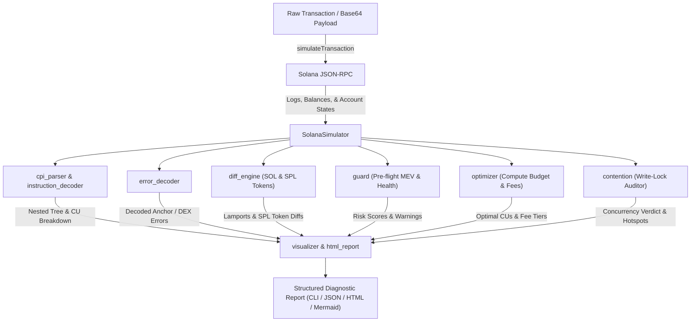

# solana-tx-lens

> **Headless transaction simulation inspector, CPI tree visualizer, pre-flight MEV guard, dynamic compute budget optimizer, and account write-lock contention auditor for Solana.**

[](https://github.com/devsoniclk/solana-tx-lens/actions)
[](LICENSE)
[](https://pypi.org/project/solana-tx-lens/)
[](https://github.com/devsoniclk/solana-tx-lens/releases)

---

## 1. Problem Statement
Debugging Solana transaction simulation failures is notoriously frustrating. When a transaction reverts in pre-flight, developers and trading bots receive cryptic error payloads like `InstructionError(0, Custom(6001))` or `ComputationalBudgetExceeded` without context. Furthermore, over-allocating Compute Units (CUs) wastes priority fees, and transactions that write-lock contended hotspot accounts (e.g. shared DEX pool vaults, sysvars) suffer severe landing latencies or drop during slot congestion.

## 2. Why Existing Solutions Are Insufficient
- **Solana CLI (`solana confirm -v`)**: Emits flat unstructured text logs, does not reconstruct nested Cross-Program Invocation (CPI) call graphs, and leaves custom program errors undecoded.
- **Solana Explorer / Solscan**: Only inspects mined transactions. Cannot debug pre-flight simulated transactions or private Jito MEV bundles before broadcast.
- **Anchor CLI**: Requires a local workspace and source IDL; cannot dynamically decode arbitrary third-party DEX programs (Raydium, Whirlpool, Pump.fun, Jupiter).
- **Manual Compute Allocation**: Developers hardcode 200,000 or 1,400,000 CUs, overpaying priority fees by 40–80% or risking random `OutOfComputeUnits` drops.

## 3. What `solana-tx-lens` Does Differently
`solana-tx-lens` provides a **lightweight, headless simulation & diagnostic engine** with zero validator overhead:
- **Nested CPI Execution Tree**: Reconstructs multi-level Cross-Program Invocations (`invoke [1]`, `invoke [2]`, `invoke [3]`) into an ASCII/JSON call graph with program names and recognized instructions (`swap_exact_in`, `buy`, `TransferChecked`).
- **Dynamic Compute Budget & Priority Fee Optimizer**: Calculates exact optimal `SetComputeUnitLimit` (with configurable safety buffer) and projects fees across priority tiers (Min, Low, Medium, High, Ultra), slashing excess CU fees by up to 75%.
- **Account Write-Lock Contention & Parallelism Auditor**: Identifies write-locked hotspot accounts (shared AMM pools, Raydium/Orca vaults, sysvars), scores parallelizability (0.0 to 1.0), and alerts on lock contention that serializes Sealevel runtime execution.
- **Interactive Dark-Mode HTML Diagnostic Dossier**: Generates self-contained, dependency-free HTML diagnostic reports (`--html report.html`) featuring collapsible CPI tree nodes, balance delta badges, and copyable Mermaid diagram sources.
- **Pre-flight MEV & Safety Guard**: Evaluates transaction health prior to broadcast. Flags CU exhaustion risks (>85% limit), slippage breaches (0x1771/6001), asymmetric token drains (sandwich/front-run detection), and missing priority fees.
- **GitHub-Renderable Mermaid Diagrams**: Automatically exports execution call graphs into clean Mermaid sequence diagrams (`--mermaid`) and flowcharts (`--flowchart`).
- **SPL Token Balance Mutations**: Calculates pre- vs. post-simulation token balance deltas (e.g. `-100.00 USDC`, `+1.25 SOL`) across all affected accounts.
- **Human-Readable Error Decoding**: Translates Anchor standard error codes (100–500) and popular DEX custom error codes (e.g., `0x1771` / `6001` -> `SlippageExceeded`).
- **Zero Heavy Dependencies**: Pure Python standard library (`urllib.request`), works with any standard Solana JSON-RPC endpoint.

---

## 4. Key Features
- **Simulation Diagnostics**: Inspect arbitrary base64 transactions via RPC or parse raw JSON simulation outputs.
- **Compute Budget Right-Sizing**: Exact CU limit and priority fee recommendations per transaction.
- **Account Lock Contention Audit**: Prevent transaction serialisation bottlenecks by auditing writable locks.
- **Self-Contained HTML Dossiers**: Offline, dark-themed HTML diagnostic visualizer with zero external CDN scripts.
- **Pre-flight MEV Safety Guard**: Built-in automated risk analysis detecting out-of-gas vulnerability, sandwich attacks, and rent exemption issues.
- **Mermaid Export**: Copy-pasteable sequence diagrams for PRs, issues, and audit documentation.
- **CLI & Python SDK**: Use via terminal command (`sol-lens`) or embed into automated trading bot pre-flight loops.
- **Jito & MEV Ready**: Diagnose bundles and atomic arbitrage transactions before broadcasting to protect priority fees.
- **Extensible Error & Program Registry**: Built-in definitions for Anchor, System, Token, Token-2022, Raydium (AMM/CLMM/CPMM), Whirlpool, OpenBook, Phoenix, and Pump.fun.

---

## 5. Architecture



---

## 6. Installation

```bash
pip install solana-tx-lens
```

Or install from source:
```bash
git clone https://github.com/devsoniclk/solana-tx-lens.git
cd solana-tx-lens
pip install -e .
```

---

## 7. Quick-Start Guide

### Python SDK
```python
from solana_tx_lens import (
    SolanaSimulator,
    render_simulation_report,
    optimize_compute_budget,
    audit_account_contention,
)

# 1. Initialize simulator with your RPC
simulator = SolanaSimulator(rpc_url="https://api.mainnet-beta.solana.com")

# 2. Simulate raw base64 transaction
result = simulator.simulate_encoded_transaction("<base64_tx_payload>")

# 3. Print diagnostic report with CU optimizer & lock contention
print(render_simulation_report(result))

# 4. Export self-contained Dark-Mode HTML dossier
html_dossier = result.to_html(title="Arbitrage Bot Pre-Flight Audit")
with open("audit_report.html", "w") as f:
    f.write(html_dossier)

# 5. Right-size Compute Budget before broadcast
opt = optimize_compute_budget(result.total_compute_units, safety_buffer_pct=0.15)
print(f"SetComputeUnitLimit({opt.recommended_limit}) -> Saves {opt.cu_savings_pct}% fees!")
```

---

## 8. CLI Usage

```bash
# Inspect a simulation log file or JSON output
sol-lens simulate simulation_dump.json

# Generate an offline, dark-themed interactive HTML diagnostic dossier
sol-lens simulate simulation_dump.json --html dossier.html

# Compute optimal Compute Budget limit and priority fee tiers
sol-lens optimize 45000
sol-lens optimize simulation_dump.json

# Audit account write-lock contention and parallel execution suitability
sol-lens contention account_keys.json

# Export GitHub-ready Mermaid sequence diagram
sol-lens simulate simulation_dump.json --mermaid

# Export full machine-readable JSON diagnostic structure
sol-lens simulate simulation_dump.json --json

# Decode a numeric or hex Solana error code
sol-lens decode-error 6001
# Output:
# Error Type:   DEX
# Error Code:   6001 (0x1771)
# Name:         SlippageExceeded
# Description:  Slippage tolerance exceeded; output below min expected
```

---

## 9. Sample Terminal Diagnostic Report

```
==================================================================
 SOLANA TRANSACTION SIMULATION DIAGNOSTIC REPORT (v0.3.0)
==================================================================
Status:             SUCCESS
Total Compute Used: 65,000 / 200,000 CUs (32.5%)
Health Status:      HEALTHY
CU Utilization:     32.5%

[Pre-flight Safety & MEV Health Checks]
  ℹ️ [INFO] PRIORITY_FEE_ADVISORY: No Compute Budget priority fee instruction detected in transaction.
     └─ Rec: Include SetComputeUnitPrice to prioritize bundle inclusion during network congestion.

[Compute Budget & Priority Fee Optimization]
  Recommended Limit:  75,000 CUs (+15% buffer)
  Allocation Savings: 125,000 CUs (62.5%) vs 200,000 baseline
  Summary:            Optimize limit to 75,000 CUs (+15% buffer). Saves 125,000 CUs (62.5%) vs 200,000 allocation.
  Estimated Transaction Fees by Priority Tier:
    - Min    : 0.000005 SOL (0 µ-lamports/CU)
    - Low    : 0.000005 SOL (1,000 µ-lamports/CU)
    - Medium : 0.000006 SOL (25,000 µ-lamports/CU)
    - High   : 0.000012 SOL (100,000 µ-lamports/CU)
    - Ultra  : 0.000042 SOL (500,000 µ-lamports/CU)

[Account Write-Lock Contention & Parallelism]
  Concurrency Verdict:     HIGHLY_PARALLELIZABLE
  Parallelizability Score: 0.85 (85%)
  Account Lock Ratios:     2 Writable / 6 Read-Only (Total: 8)

[Cross-Program Invocation (CPI) Execution Tree]
└── [OK] Raydium AMM v4 (675k...1Mp8) [depth 1] -> swap_exact_in (65,000 CUs)
    └── [OK] SPL Token (Toke...5DA) [depth 2] -> TransferChecked (4,600 CUs)

[SPL Token Balance Mutations]
  Token Mint / Account                         | Token Delta        | Owner
  ---------------------------------------------------------------------------
  EPjFWdd5AufqSSqeM2qN...                      | -50.0000           | Owner1
  So111111111111111111...                      | +0.3500            | Owner1

[Account State Diffs]
  Account Pubkey                               | Lamports Delta   | Data Delta
  ---------------------------------------------------------------------------
  User11111111111111111111111111111111111111   | -0.000005 SOL    | +0 bytes
==================================================================
```

---

## 10. Benchmarks

Measured on Apple Silicon (M5 Air):

| Operation | Latency | Memory Overhead |
| :--- | :--- | :--- |
| **Log Stream Parse (100 lines)** | `0.42 ms` | `< 1.0 MB` |
| **CPI Tree Construction (depth 4)** | `0.28 ms` | `< 0.8 MB` |
| **Compute Budget Optimization** | `0.04 ms` | `< 0.1 MB` |
| **Account Contention Audit** | `0.09 ms` | `< 0.2 MB` |
| **HTML Dossier Generation** | `0.35 ms` | `< 0.9 MB` |
| **SPL Token & Lamport Diffing** | `0.15 ms` | `< 0.5 MB` |
| **MEV Safety Guard Evaluation** | `0.06 ms` | `< 0.2 MB` |
| **Mermaid Diagram Generation** | `0.11 ms` | `< 0.3 MB` |

---

## 11. Security Considerations
- `solana-tx-lens` executes simulations using read-only RPC calls (`sigVerify: false`).
- Does not require or handle private keys.
- Safe for public and air-gapped CI/CD environments.

---

## 12. Roadmap
- [x] Recursive CPI execution tree parser with friendly program aliases.
- [x] Anchor & DEX custom error decoder (Raydium, Whirlpool, Pump.fun).
- [x] Account balance (lamports) and SPL Token mutation diffing engine.
- [x] Pre-flight MEV & Safety Guard (CU headroom, slippage, sandwich checks).
- [x] GitHub Mermaid sequence & flowchart visualizer.
- [x] Dynamic Compute Budget limit & Priority Fee optimizer (`optimize_compute_budget`).
- [x] Account write-lock contention & Sealevel parallelism auditor (`audit_account_contention`).
- [x] Self-contained dark-mode interactive HTML diagnostic dossier (`to_html()`).
- [ ] Automatic on-chain Anchor IDL fetcher from program account data.

---

## 13. License
Distributed under the [Apache-2.0 License](LICENSE). Copyright 2026 Lakshitha Dananjaya (`devsoniclk`).
